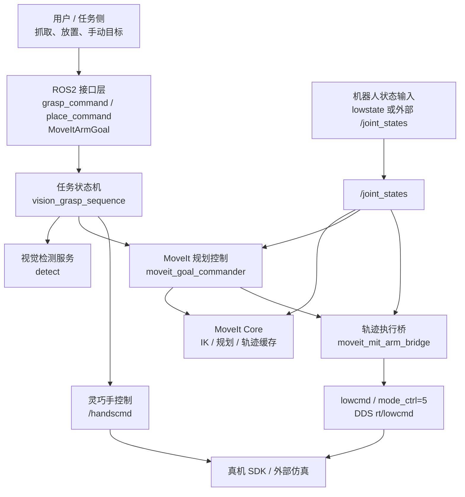
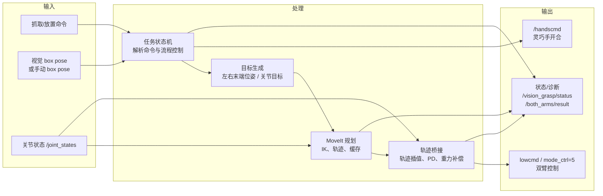
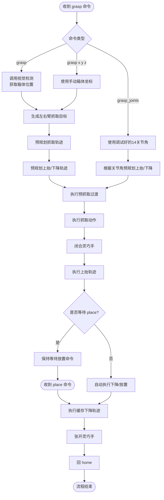
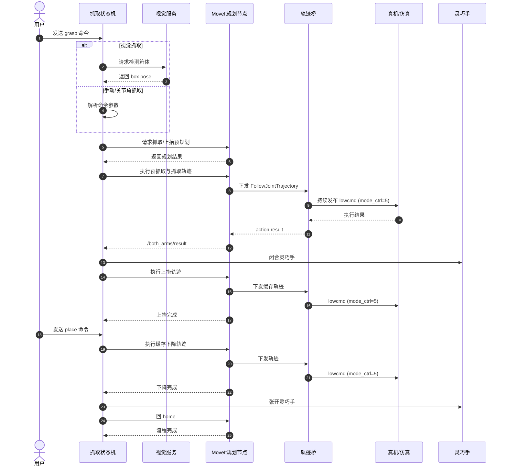
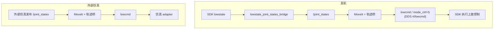

# qiling_s4 项目流程图

本文档用 Mermaid 描述 qiling_s4 当前上肢控制项目的核心流程。图中只保留关键模块、关键数据和主要阶段，便于快速理解整体系统。

## 软件架构图

## 数据流图

## 抓取算法流程图

## 运行时序图

## 真机与外部仿真链路

## 说明

- 当前项目主职责是双臂上肢控制；下肢控制不在 qiling_s4 侧处理。
- 真机向 `lowcmd`（DDS `rt/lowcmd`）发全身长度 `LowCmd` 且设置 `mode_ctrl=5`；SDK 用已缓存的策略腿替换包内腿部占位数据。
- `/handsstate` 当前只缓存，不作为闭环控制依据；灵巧手动作由 `/handscmd` 开环下发。
- 真机和仿真都依赖唯一有效的 `/joint_states`，不要同时启动多个状态源。
